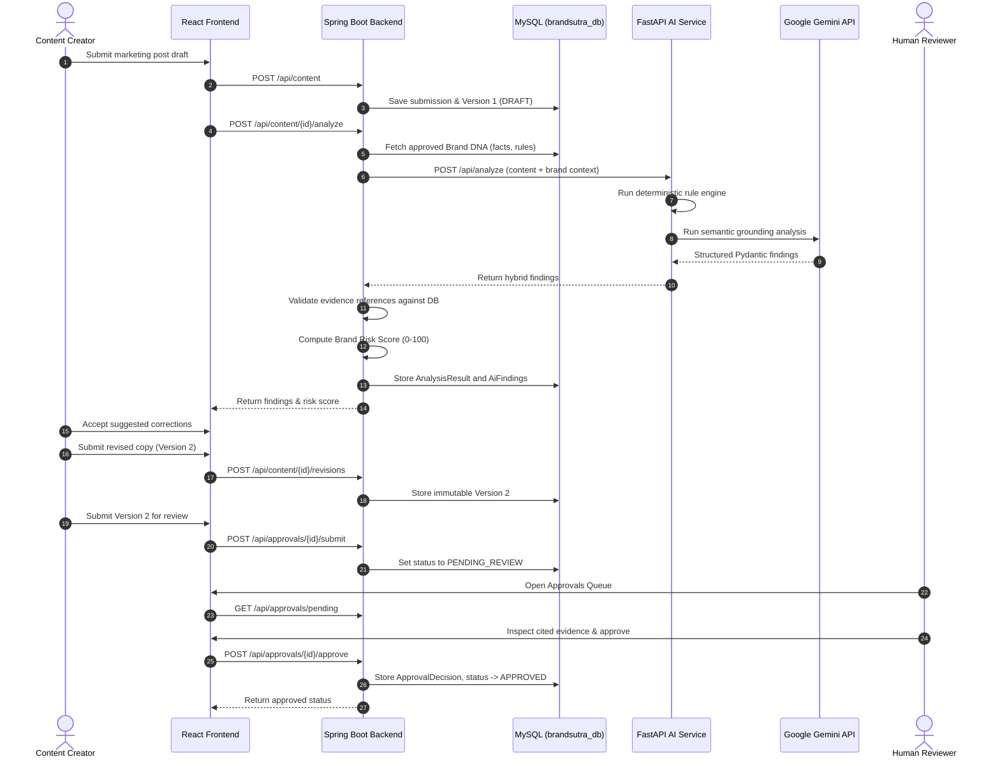

# BrandSutra Architecture Documentation

## 1. System Overview

**BrandSutra** ("Your Brand. Your Rules. AI-Powered Confidence.") is an explainable AI-powered brand governance and pre-publication content verification platform built for the **AVINYA Hackathon** (Problem Statement Provider: **Inkloom AI**).

The system automates the verification of marketing communications (social media posts, advertisements, website copy, promotional campaigns) against an organization's authoritative **Brand DNA** knowledge base.

```
+-------------------------------------------------------------------------+
|                              React Frontend                             |
|             (Vite, Tailwind CSS, Recharts, Lucide Icons)                |
+-------------------------------------------------------------------------+
                                    |
                                    | HTTPS / REST / JWT Bearer
                                    v
+-------------------------------------------------------------------------+
|                        Spring Boot Backend (Java 21)                    |
|    - Authentication & Authorization (Spring Security + JWT)             |
|    - Multi-Tenant Organization Data Isolation                           |
|    - Content Versioning & Immutable History                             |
|    - Human Approval Workflow Engine                                     |
|    - Risk Scoring Engine & SQL Analytics Aggregation                    |
|    - Strict Evidence Reference Validation                               |
+-------------------------------------------------------------------------+
         |                                                 |
         | Spring Data JPA / JDBC                          | HTTP / Service Key
         v                                                 v
+-----------------------+              +----------------------------------+
|    MySQL 8+ Database  |              |   FastAPI AI Microservice (Py3.11)|
|    (brandsutra_db)    |              | - Deterministic Safety Engine    |
| - 13 Relational Tables|              | - PyMuPDF Guideline Extraction   |
| - Foreign Keys        |              | - Gemini 2.5 Flash Grounding     |
| - Audit Logs          |              | - Anti-Prompt-Injection Sandbox  |
+-----------------------+              +----------------------------------+
                                                       |
                                                       | Official Google GenAI SDK
                                                       v
                                               +-------------------+
                                               |  Google Gemini API|
                                               +-------------------+
```

---

## 2. Multi-Tier Security & Isolation

### A. Role-Based Access Control (RBAC)
BrandSutra enforces three distinct roles:
1. **ADMIN**: Full organization management, Brand DNA administration (facts, rules, guidelines), user role assignments, audit logs, and governance metrics.
2. **CONTENT_CREATOR**: Drafts marketing copy, runs live AI analysis, reviews explainable findings, creates immutable revision versions, and submits compliant versions for human review.
3. **REVIEWER**: Accesses the pending approval queue, inspects highlighted brand risks, reviews cited Brand DNA evidence, and issues authoritative decisions (`APPROVED`, `REJECTED`, `CHANGES_REQUESTED`) with audit comments.

### B. Tenant Data Isolation
Every data entity (`brand_facts`, `brand_rules`, `brand_guidelines`, `content_submissions`, `approval_decisions`) is linked to an `organization_id`. Spring Boot services validate that the requesting user belongs to the target organization before querying or mutating data.

### C. Service-to-Service Security
Communication between Spring Boot and the FastAPI AI microservice is authenticated using a shared service token (`X-AI-Service-Key`). The AI service is strictly private and cannot be invoked directly by client browsers.

---

## 3. End-to-End Content Governance Workflow



---

## 4. Hybrid Verification & Risk Scoring Engine

BrandSutra combines deterministic rule checking with deep semantic verification:

1. **Deterministic Rule Engine (FastAPI)**:
   - High-speed regex checks for banned and restricted terminology.
   - Contextual extraction and threshold checking for discount percentages (flags claims exceeding approved caps).
   - Warranty duration analysis (flags general claims exceeding standard terms).
   - Mandatory disclaimer validation.

2. **Semantic Grounding (Gemini 2.5 Flash)**:
   - Evaluates brand voice and tone consistency.
   - Identifies subtle unsupported claims and misleading statements.
   - Cites strictly approved Brand DNA evidence provided in the request payload.
   - Anti-prompt-injection isolation ensures submitted marketing text cannot hijack model instructions.

3. **Risk Scoring Formula**:
   $$\text{Risk Score} = \min\left(100, \sum_{\text{findings}} \text{Weight}(\text{severity})\right)$$
   - `CRITICAL`: 40 points
   - `HIGH`: 25 points
   - `MEDIUM`: 15 points
   - `LOW`: 5 points

| Risk Score Range | Severity Level | Publication Recommendation |
| :--- | :--- | :--- |
| **0 – 20** | **LOW** | Safe for immediate review / publication |
| **21 – 40** | **MEDIUM** | Minor wording improvements recommended |
| **41 – 70** | **HIGH** | Requires revision before human sign-off |
| **71 – 100** | **CRITICAL** | Severe violation; blocked from publication |
